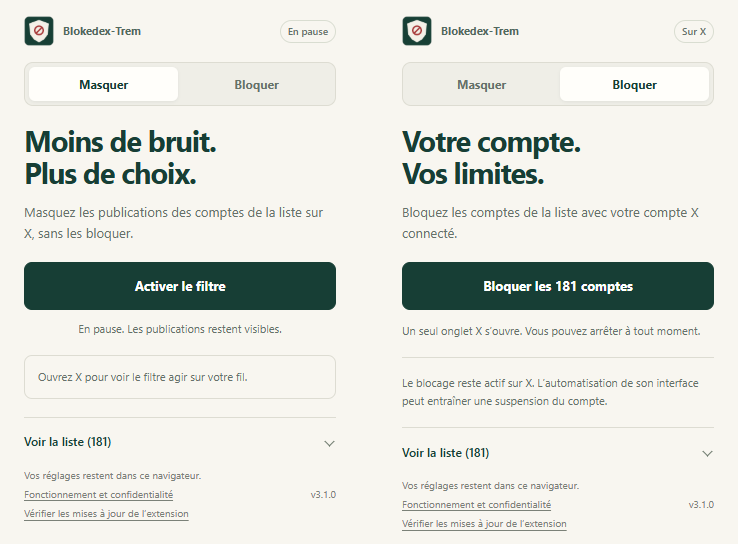

Blokedex-Trem
=============

Gardez la main sur votre fil. Deux façons de mettre à distance les 181 comptes de la liste : **Masquer** dans votre navigateur, ou **Bloquer** sur votre compte X.

La liste « Comptes sélectionnés » est un choix de l’éditeur. Y figurer n’est pas une affirmation sur les opinions ou les affiliations du titulaire. Vous pouvez la consulter avant de choisir une action.

Installation
------------

**Chrome** : télécharger le `ZIP Chrome <https://github.com/LaRosette/Blokedex-Trem/releases/latest/download/extension-chrome.zip>`_, le décompresser, ouvrir ``chrome://extensions``, activer le mode développeur puis charger le dossier contenant ``manifest.json``.

**Edge** : télécharger le `ZIP Edge <https://github.com/LaRosette/Blokedex-Trem/releases/latest/download/extension-edge.zip>`_, le décompresser puis charger le dossier depuis ``edge://extensions`` en mode développeur.

**Firefox** : télécharger le `ZIP Firefox <https://github.com/LaRosette/Blokedex-Trem/releases/latest/download/extension-firefox.zip>`_, ouvrir ``about:debugging#/runtime/this-firefox`` puis choisir « Charger un module complémentaire temporaire ». Ce mode est retiré au redémarrage. Firefox 142 ou plus récent est nécessaire. Une installation permanente exige un XPI signé par Mozilla ; aucun XPI signé n’est encore distribué.

Ouvrez X dans ce navigateur, puis l’extension. Le filtre est désactivé au premier lancement et aucun blocage ne démarre seul. Choisir un onglet dans le popup ne lance aucune action. Si X était ouvert pendant l’installation, rechargez sa page une fois.

Masquer : pour lire sans réagir
-------------------------------

Activez le filtre pour masquer les publications, les suggestions et les résultats de recherche des comptes reconnus dans la liste. Il agit sur le site X dans ce profil de navigateur, quel que soit le compte connecté. Il n’agit pas dans l’application mobile et ne modifie aucun réglage de votre compte X.

L’auteur principal décide si un post entier est masqué. Si un compte non listé cite un compte de la liste, son commentaire et ses boutons restent visibles ; seul l’encart cité est masqué. Une mention, une réponse ou un simple lien ne suffit pas à masquer le post d’un autre auteur. Les identités ambiguës restent affichées.

Une adresse de profil ouverte directement affiche « Profil masqué ». Le bouton de pause restaure la page et suspend le filtre dans ce navigateur. La navigation et votre lien de profil restent accessibles.

Les posts et cartes d’un fil conservent leur hauteur, avec un repère neutre. Cela évite de faire remonter sans cesse la zone de chargement de X lorsque tous les contenus sont masqués. Les suggestions du menu de recherche sont retirées visuellement de ce menu. Les médias masqués sont mis en pause et ne sont jamais relancés par l’extension.

**Mettre en pause restaure l’affichage.** Le compteur additionne les posts et les citations masqués séparément sur la page courante. Il ne compte ni les personnes, ni les cartes de profils, ni des vues évitées. Il peut baisser lorsque X retire des éléments du fil.

Bloquer : pour agir sur votre compte X
--------------------------------------

Dans l’onglet **Bloquer**, le bouton **Bloquer les 181 comptes** lance le traitement avec votre session X connectée. Un seul onglet de travail est ouvert dans la fenêtre courante, puis réutilisé. Vous pouvez fermer le popup : le traitement continue tant que le navigateur fonctionne. Le filtre est suspendu dans cet onglet de travail pour laisser les commandes de X accessibles ; vos autres onglets gardent leur filtre.

Le traitement vérifie le pseudo et l’identifiant numérique du profil avant les clics et avant la confirmation. Il refuse une identité différente, un menu inattendu ou un changement de compte connecté. Il distingue les nouveaux blocages, les comptes déjà bloqués et les profils indisponibles. Il n’effectue jamais de déblocage automatique.

La liste du traitement est figée au lancement. Les profils sont traités un à un, sans visites parallèles. Les passages suivants sautent les comptes déjà traités pour le même utilisateur lorsque son identité locale peut être reconnue. Cet historique est un aide-mémoire : si vous avez débloqué un compte vous-même sur X, **Revérifier toute la liste sur X** permet un nouveau contrôle.

**Arrêter** interrompt les clics suivants et conserve les blocages déjà effectués. Une action déjà envoyée à X peut encore aboutir. Une erreur, une page qui ne répond pas ou une identité douteuse met le traitement en pause. Une limitation signalée par X impose au moins quinze minutes d’attente, sans reprise automatique. Après un redémarrage, il faut reprendre volontairement. Aucune durée totale n’est garantie.

Chaque utilisateur agit sur son propre compte X. L’historique de traitement est séparé par compte, conservé localement, limité à cinq comptes et effaçable depuis l’onglet Bloquer. **Effacer cet historique ne débloque personne sur X.** Le blocage lui-même reste actif sur vos autres appareils et après la désinstallation de l’extension. X permet de revenir dessus depuis ses réglages.

Selon l’`aide officielle de X sur le blocage <https://help.x.com/en/using-x/blocking-and-unblocking-accounts>`_, bloquer empêche notamment les interactions et les abonnements entre ces comptes. Cela ne rend pas vos posts publics invisibles au compte bloqué : celui-ci peut encore les consulter. Le blocage peut aussi supprimer vos abonnements réciproques.

Masquer, ignorer ou bloquer : que choisir ?
-------------------------------------------

Pour ne plus vous arrêter sur ces contenus dans votre navigateur, **Masquer** est le choix le plus immédiat et le plus facilement réversible. Pour empêcher aussi un compte d’interagir avec le vôtre et appliquer ce choix sur tous vos appareils, **Bloquer** répond à un autre besoin. Le bouton natif **Masquer / Mute** de X est encore une troisième option : il change vos réglages sur X sans bloquer la personne. Notre filtre local ne l’active pas.

.. list-table::
   :header-rows: 1
   :widths: 22 38 40

   * - Choix
     - Effet pour vous
     - Signal à X
   * - Ignorer en faisant défiler
     - Vous poursuivez la lecture sans réagir.
     - Pas de clic de blocage ou de mise en sourdine ; l’exposition peut être mesurée par X.
   * - Masquer avec l’extension
     - Le contenu reconnu est caché dans ce navigateur.
     - Aucun événement natif « mute », « block » ou « Pas intéressé » envoyé par le filtre. X peut avoir déjà chargé le contenu.
   * - Masquer avec le bouton de X
     - Mise en sourdine enregistrée sur votre compte ; règles propres à X selon les conversations.
     - Action « mute » connue de X.
   * - Bloquer sur X
     - Posts retirés du fil et interactions restreintes selon les règles de X.
     - Action « block » connue de X ; aucune baisse globale de portée garantie.

Voir aussi l’`aide X sur la mise en sourdine <https://help.x.com/en/using-x/x-mute>`_. Les trois choix d’affichage ne sont pas interchangeables.

Ce que disent les coefficients publiés
--------------------------------------

Vérification du 29 octobre 2026 dans le `code public de X <https://github.com/xai-org/x-algorithm/blob/606b254b45be798bfaecfa8c23f5a9c51bc8000c/home-mixer/params/param.rs#L368-L508>`_. Ces paramètres pondèrent des **probabilités prédites**, pas des points attribués à chaque clic.

.. list-table::
   :header-rows: 1

   * - Réaction prédite
     - Coefficient publié
   * - Copie du lien
     - +20
   * - Réponse
     - +5
   * - Repost
     - +1
   * - J’aime
     - +0,66
   * - Blocage de l’auteur
     - −31,2
   * - Mise en sourdine native
     - −58,8
   * - Signalement
     - −234

Une probabilité de blocage de 1 % pondérée par −31,2 contribue par exemple −0,312 à ce terme. Ce n’est pas une pénalité de 31,2 à chaque blocage. Les autres termes, les étapes de sélection et les paramètres effectifs comptent aussi.

Les commentaires du code précisent que les recommandations sont personnalisées et qu’une action après navigation directe vers un post n’a pas l’effet de classement d’une action dans le fil d’accueil. Un blocage depuis un profil ne prouve donc aucune baisse mesurable de portée. On ne peut pas déduire de ces seuls chiffres que bloquer, ignorer ou masquer « vaut » un certain nombre de likes, ni que l’un fait systématiquement mieux que l’autre.

Le manuel partagé
-----------------

Le `Mini-manuel d’insurrection informationnelle <https://fr.scribd.com/document/1091095610/Mini-manuel-D-Insurrection-Informationelle-ou-Janonisme-pdf>`_ présente une stratégie militante. Les pages 9 et 12 conseillent d’éviter les interactions avec les publications adverses et recommandent aussi le blocage préventif. Il ne préconise donc pas uniquement d’ignorer sans bloquer. Ce texte n’est ni une documentation technique de X ni une démonstration de l’effet actuel de son algorithme.

Blokedex-Trem retient un usage individuel : choisir ce que l’on voit et éviter les réactions par réflexe. Il ne programme ni publications, ni likes, ni réponses, ni signalements, ni opérations coordonnées. Il ne fabrique pas d’impressions ou de temps de lecture. Le masquage local ne garantit pas qu’une publication n’a pas déjà été comptabilisée comme vue.

Les règles de X et les limites
------------------------------

**Le blocage automatique par l’interface n’est pas présenté comme conforme aux règles de X.** Ses `règles d’automatisation <https://help.x.com/en/rules-and-policies/x-automation>`_ interdisent l’automatisation du site par script et prévoient une possible suspension, y compris permanente. Une cadence limitée, les contrôles d’identité et les pauses réduisent certaines erreurs techniques ; ils ne rendent pas le comportement humain et n’annulent pas ce risque. Nous n’avons pas de mesure fiable permettant de le qualifier de faible.

Le filtrage local évite ces clics automatiques et sert à personnaliser votre affichage. Il ne constitue pas une autorisation de X ou une garantie contractuelle. Les `conditions de X <https://x.com/en/tos>`_ et les `règles d’authenticité <https://help.x.com/en/rules-and-policies/authenticity>`_ restent applicables. Aucune restriction, aucun défi de connexion et aucune limite de X ne sont contournés.

Mises à jour
------------

La liste incluse est vérifiée toutes les six heures lorsque le navigateur est ouvert. **Actualiser la liste** permet une vérification manuelle. Le cache valide ou la copie incluse sert de secours si GitHub est indisponible. Une pastille sur l’icône et un encart signalent les nouveaux comptes. Le filtre actif prend ces ajouts en compte automatiquement ; les bloquer exige un nouveau lancement volontaire. Aucun ajout ne déclenche de blocage en arrière-plan.

**La liste et le logiciel se mettent à jour séparément.** Les ZIP Chrome et Edge installés manuellement exigent de remplacer les fichiers dans le même dossier, puis de recharger l’extension. Le popup signale les nouvelles versions publiées. Les mises à jour natives exigent une distribution par les boutiques, où le projet n’est pas encore publié. Le canal Firefox attend un XPI signé par Mozilla.

Pour passer en **3.1**, remplacez les fichiers, rechargez l’extension puis **actualisez les pages X déjà ouvertes**. Le choix d’activation du filtre de la version 3.0 est conservé. Depuis les versions antérieures à la 3.0, les anciennes tâches et données locales sont retirées et le filtre est initialement désactivé. Les blocages déjà présents sur X restent actifs.

Proposer un compte ou demander un retrait
-----------------------------------------

Pour demander un ajout, une correction ou **le retrait d’un nom**, contactez `@MEYTRED sur X <https://x.com/MEYTRED>`_ avec le lien du profil concerné. Seul l’éditeur publie les modifications de la liste officielle ; les demandes ne sont pas ajoutées automatiquement. Un retrait cesse le filtrage après réception de la nouvelle liste, sans débloquer automatiquement un compte sur X. Ne publiez aucun mot de passe, cookie ou document d’identité dans une issue.

Comptes sélectionnés
--------------------

.. comptes:debut

**181 comptes** · liste 2026-10-28.2

Ce tableau suit les comptes sélectionnés pour le filtre local. Aucun historique de lecture n’est collecté.

.. list-table::
   :header-rows: 1
   :widths: 20 20 20 20 20

   * - _ – C
     - C – G
     - G – L
     - L – R
     - R – Z
   * - `@_LesPatriotes <https://x.com/_LesPatriotes>`_
     - `@CathRimbert84 <https://x.com/CathRimbert84>`_
     - `@guillaumefl59 <https://x.com/guillaumefl59>`_
     - `@louis_aliot <https://x.com/louis_aliot>`_
     - `@RomainTonussi <https://x.com/RomainTonussi>`_
   * - `@A_Dutremble <https://x.com/A_Dutremble>`_
     - `@CColombier_RN <https://x.com/CColombier_RN>`_
     - `@HdeLepinau <https://x.com/HdeLepinau>`_
     - `@LRDehault <https://x.com/LRDehault>`_
     - `@RoullaudBeatric <https://x.com/RoullaudBeatric>`_
   * - `@A_Masson06 <https://x.com/A_Masson06>`_
     - `@Cengrand_ <https://x.com/Cengrand_>`_
     - `@HeleneLaporteRN <https://x.com/HeleneLaporteRN>`_
     - `@M_Dauchy <https://x.com/M_Dauchy>`_
     - `@RTolassy <https://x.com/RTolassy>`_
   * - `@Al_Nikolic <https://x.com/Al_Nikolic>`_
     - `@ChristineLoirRN <https://x.com/ChristineLoirRN>`_
     - `@ID_Libertes <https://x.com/ID_Libertes>`_
     - `@MagLincorrect <https://x.com/MagLincorrect>`_
     - `@S_Werbrouck <https://x.com/S_Werbrouck>`_
   * - `@AlexandreDfss <https://x.com/AlexandreDfss>`_
     - `@ChudeauR <https://x.com/ChudeauR>`_
     - `@J_Bardella <https://x.com/J_Bardella>`_
     - `@MalikaSorel <https://x.com/MalikaSorel>`_
     - `@Samuel_Lafont <https://x.com/Samuel_Lafont>`_
   * - `@AlexandreLoubet <https://x.com/AlexandreLoubet>`_
     - `@ClaireBeuil <https://x.com/ClaireBeuil>`_
     - `@J_Rancoule <https://x.com/J_Rancoule>`_
     - `@MAndrouet <https://x.com/MAndrouet>`_
     - `@SandraDELANNOY1 <https://x.com/SandraDELANNOY1>`_
   * - `@AlexandreVaraut <https://x.com/AlexandreVaraut>`_
     - `@CNEWS <https://x.com/CNEWS>`_
     - `@JeanMessiha <https://x.com/JeanMessiha>`_
     - `@MarcDeFleurian <https://x.com/MarcDeFleurian>`_
     - `@Sandrine_Dogor <https://x.com/Sandrine_Dogor>`_
   * - `@alexisjollyrn <https://x.com/alexisjollyrn>`_
     - `@Coll_Nemesis <https://x.com/Coll_Nemesis>`_
     - `@jerome_buisson <https://x.com/jerome_buisson>`_
     - `@MarchioMatthieu <https://x.com/MarchioMatthieu>`_
     - `@sblanc66000 <https://x.com/sblanc66000>`_
   * - `@Anais_Sabatini <https://x.com/Anais_Sabatini>`_
     - `@CordierAlice2 <https://x.com/CordierAlice2>`_
     - `@JLechanteux <https://x.com/JLechanteux>`_
     - `@MarieLuceBC <https://x.com/MarieLuceBC>`_
     - `@seb_humbert <https://x.com/seb_humbert>`_
   * - `@AndreRougeOff <https://x.com/AndreRougeOff>`_
     - `@DamienRieu <https://x.com/DamienRieu>`_
     - `@JLeonardelli_ <https://x.com/JLeonardelli_>`_
     - `@marine_hamelet <https://x.com/marine_hamelet>`_
     - `@sebchenu <https://x.com/sebchenu>`_
   * - `@angelique_ranc <https://x.com/angelique_ranc>`_
     - `@diaz_edwige <https://x.com/diaz_edwige>`_
     - `@jllacapelle <https://x.com/jllacapelle>`_
     - `@MarionMarechal <https://x.com/MarionMarechal>`_
     - `@Serge_Muller24 <https://x.com/Serge_Muller24>`_
   * - `@AnneSicard1 <https://x.com/AnneSicard1>`_
     - `@e_Fouquart <https://x.com/e_Fouquart>`_
     - `@JocelynDessigny <https://x.com/JocelynDessigny>`_
     - `@MassonBryan <https://x.com/MassonBryan>`_
     - `@SJosserand30 <https://x.com/SJosserand30>`_
   * - `@AntBoulogne54 <https://x.com/AntBoulogne54>`_
     - `@EddyCasterman <https://x.com/EddyCasterman>`_
     - `@JoelleMelinRN <https://x.com/JoelleMelinRN>`_
     - `@MatthiasRN <https://x.com/MatthiasRN>`_
     - `@sRambaudRN <https://x.com/sRambaudRN>`_
   * - `@antoine_golliot <https://x.com/antoine_golliot>`_
     - `@EmericSalmon <https://x.com/EmericSalmon>`_
     - `@jordan_guitton <https://x.com/jordan_guitton>`_
     - `@MauvieuxKevin <https://x.com/MauvieuxKevin>`_
     - `@T_Houssin <https://x.com/T_Houssin>`_
   * - `@ArnaudSa3 <https://x.com/ArnaudSa3>`_
     - `@Europe1 <https://x.com/Europe1>`_
     - `@JorysB3 <https://x.com/JorysB3>`_
     - `@MaximeAmblard5 <https://x.com/MaximeAmblard5>`_
     - `@TaverneMichael <https://x.com/TaverneMichael>`_
   * - `@ASabatou <https://x.com/ASabatou>`_
     - `@F_Desouche <https://x.com/F_Desouche>`_
     - `@joshuaHochart <https://x.com/joshuaHochart>`_
     - `@melanie_disdier <https://x.com/melanie_disdier>`_
     - `@tegnererik <https://x.com/tegnererik>`_
   * - `@asfrigout <https://x.com/asfrigout>`_
     - `@f_philippot <https://x.com/f_philippot>`_
     - `@JPGarraud <https://x.com/JPGarraud>`_
     - `@Meurin_P <https://x.com/Meurin_P>`_
     - `@Th_Bnrdt <https://x.com/Th_Bnrdt>`_
   * - `@Au_Evrard <https://x.com/Au_Evrard>`_
     - `@FabriceLeggeri <https://x.com/FabriceLeggeri>`_
     - `@JphTanguy <https://x.com/JphTanguy>`_
     - `@MichelGuiniot <https://x.com/MichelGuiniot>`_
     - `@ThaisEscufon <https://x.com/ThaisEscufon>`_
   * - `@AymericDurox <https://x.com/AymericDurox>`_
     - `@FalconFrederic <https://x.com/FalconFrederic>`_
     - `@jrechagneux <https://x.com/jrechagneux>`_
     - `@MichleMartinez3 <https://x.com/MichleMartinez3>`_
     - `@thierry_frappe <https://x.com/thierry_frappe>`_
   * - `@BallardPhilippe <https://x.com/BallardPhilippe>`_
     - `@Flo_Joubert <https://x.com/Flo_Joubert>`_
     - `@JRochedy <https://x.com/JRochedy>`_
     - `@MLP_officiel <https://x.com/MLP_officiel>`_
     - `@ThierryMARIANI <https://x.com/ThierryMARIANI>`_
   * - `@BarthesChristop <https://x.com/BarthesChristop>`_
     - `@FlorenceGoulet4 <https://x.com/FlorenceGoulet4>`_
     - `@jsanchez_rn <https://x.com/jsanchez_rn>`_
     - `@MoniqueGriseti <https://x.com/MoniqueGriseti>`_
     - `@thierryperez_ <https://x.com/thierryperez_>`_
   * - `@BaubryR <https://x.com/BaubryR>`_
     - `@FranceJamet <https://x.com/FranceJamet>`_
     - `@Julien_Limongi <https://x.com/Julien_Limongi>`_
     - `@MonnierThibaut <https://x.com/MonnierThibaut>`_
     - `@Thomas_Mng <https://x.com/Thomas_Mng>`_
   * - `@Bay_Christophe <https://x.com/Bay_Christophe>`_
     - `@FranceLorho <https://x.com/FranceLorho>`_
     - `@JulienGabarron <https://x.com/JulienGabarron>`_
     - `@mvalet_officiel <https://x.com/mvalet_officiel>`_
     - `@Tiffany_Joncour <https://x.com/Tiffany_Joncour>`_
   * - `@BeaurainJose <https://x.com/BeaurainJose>`_
     - `@franckallisio <https://x.com/franckallisio>`_
     - `@JulienOdoul <https://x.com/JulienOdoul>`_
     - `@NadineLechonRN <https://x.com/NadineLechonRN>`_
     - `@tvlofficiel <https://x.com/tvlofficiel>`_
   * - `@BeneAuzanot <https://x.com/BeneAuzanot>`_
     - `@FrankGiletti <https://x.com/FrankGiletti>`_
     - `@jylgallou <https://x.com/jylgallou>`_
     - `@NathCarvalho91 <https://x.com/NathCarvalho91>`_
     - `@TwitchGauchiste <https://x.com/TwitchGauchiste>`_
   * - `@BentzChristophe <https://x.com/BentzChristophe>`_
     - `@FredericVos <https://x.com/FredericVos>`_
     - `@K_Pfeffer <https://x.com/K_Pfeffer>`_
     - `@NicolasDragon <https://x.com/NicolasDragon>`_
     - `@v_joron <https://x.com/v_joron>`_
   * - `@BFMTV <https://x.com/BFMTV>`_
     - `@Frontieresmedia <https://x.com/Frontieresmedia>`_
     - `@knafo_sarah <https://x.com/knafo_sarah>`_
     - `@NMeizonnet <https://x.com/NMeizonnet>`_
     - `@ValerieDeloge <https://x.com/ValerieDeloge>`_
   * - `@BlairyEmmanuel <https://x.com/BlairyEmmanuel>`_
     - `@furet_angeline <https://x.com/furet_angeline>`_
     - `@LaureLavalette <https://x.com/LaureLavalette>`_
     - `@Parmentier_RN <https://x.com/Parmentier_RN>`_
     - `@Valeurs <https://x.com/Valeurs>`_
   * - `@Boccaletti83 <https://x.com/Boccaletti83>`_
     - `@G_Dussausaye <https://x.com/G_Dussausaye>`_
     - `@LaurentObertone <https://x.com/LaurentObertone>`_
     - `@PascalePiera <https://x.com/PascalePiera>`_
     - `@villedieu_a <https://x.com/villedieu_a>`_
   * - `@Bruno_Attal_ <https://x.com/Bruno_Attal_>`_
     - `@GabrielAttal <https://x.com/GabrielAttal>`_
     - `@LeBourgeois7610 <https://x.com/LeBourgeois7610>`_
     - `@Ph_Schreck <https://x.com/Ph_Schreck>`_
     - `@WEBERFrederic1 <https://x.com/WEBERFrederic1>`_
   * - `@BrunoBilde <https://x.com/BrunoBilde>`_
     - `@GalzyStephanie <https://x.com/GalzyStephanie>`_
     - `@leJDD <https://x.com/leJDD>`_
     - `@phlottiaux <https://x.com/phlottiaux>`_
     - `@YaelMenache <https://x.com/YaelMenache>`_
   * - `@BrunoClavet <https://x.com/BrunoClavet>`_
     - `@GillesPennelle <https://x.com/GillesPennelle>`_
     - `@LevavasseurK <https://x.com/LevavasseurK>`_
     - `@PhOlivierRN <https://x.com/PhOlivierRN>`_
     - `@YoannGillet30 <https://x.com/YoannGillet30>`_
   * - `@BrunoRetailleau <https://x.com/BrunoRetailleau>`_
     - `@gisele_lelouis <https://x.com/gisele_lelouis>`_
     - `@Ligne__Droite <https://x.com/Ligne__Droite>`_
     - `@PierrePimpie <https://x.com/PierrePimpie>`_
     - `@ZemmourEric <https://x.com/ZemmourEric>`_
   * - `@BVoltaire <https://x.com/BVoltaire>`_
     - `@GonzalezJoseRN <https://x.com/GonzalezJoseRN>`_
     - `@Lionel_Tivoli <https://x.com/Lionel_Tivoli>`_
     - `@PR_Thionnet <https://x.com/PR_Thionnet>`_
     - 
   * - `@C_GirardRN <https://x.com/C_GirardRN>`_
     - `@GrangierGe <https://x.com/GrangierGe>`_
     - `@LisettePollet <https://x.com/LisettePollet>`_
     - `@Reconquete_off <https://x.com/Reconquete_off>`_
     - 
   * - `@C_Jaouen_84 <https://x.com/C_Jaouen_84>`_
     - `@groupeRN_off <https://x.com/groupeRN_off>`_
     - `@ljacobelli <https://x.com/ljacobelli>`_
     - `@Rivirejoseph1 <https://x.com/Rivirejoseph1>`_
     - 
   * - `@C_Szczurek <https://x.com/C_Szczurek>`_
     - `@Guillaume_Bigot <https://x.com/Guillaume_Bigot>`_
     - `@LopezLiguori <https://x.com/LopezLiguori>`_
     - `@RNational_off <https://x.com/RNational_off>`_
     - 

.. comptes:fin

Téléchargements
---------------

Les compteurs ci-dessous mesurent les téléchargements de fichiers dans GitHub Releases. Ce ne sont ni des installations ni des personnes uniques. Aucun événement d’utilisation n’est envoyé par l’extension.

.. image:: https://img.shields.io/github/downloads/LaRosette/Blokedex-Trem/extension-chrome.zip?label=Chrome&color=183f35&displayAssetName=false
   :target: https://github.com/LaRosette/Blokedex-Trem/releases
   :alt: Téléchargements Chrome

.. image:: https://img.shields.io/github/downloads/LaRosette/Blokedex-Trem/extension-edge.zip?label=Edge&color=183f35&displayAssetName=false
   :target: https://github.com/LaRosette/Blokedex-Trem/releases
   :alt: Téléchargements Edge

.. image:: https://img.shields.io/github/downloads/LaRosette/Blokedex-Trem/extension-firefox.zip?label=Firefox&color=183f35&displayAssetName=false
   :target: https://github.com/LaRosette/Blokedex-Trem/releases
   :alt: Téléchargements Firefox

Confidentialité et limites
--------------------------

Le filtre lit les auteurs et les cartes présents dans la page, sans conserver de texte de publication ni d’historique de lecture. Le mode Bloquer lit le compte connecté et les commandes des profils pour vérifier les identités. Il conserve localement la progression, le pseudo du compte utilisé, une empreinte dérivée de son avatar et les identifiants déjà traités. Cette empreinte est un repère technique local, pas un anonymat garanti. Aucun mot de passe, cookie ou jeton de session n’est lu par l’extension.

Aucun serveur applicatif ne reçoit ces données ; il n’y a ni publicité ni télémétrie. GitHub reçoit les informations réseau habituelles des téléchargements de liste et de version, dont l’adresse IP. Ces requêtes n’envoient ni identité X, ni contenu de votre fil, ni cookies GitHub. Les JSON distants contiennent des données, jamais du code exécuté par l’extension. Les compteurs GitHub portent sur les téléchargements, pas sur l’utilisation.

Mettre le filtre en pause restaure l’affichage. Arrêter le blocage interrompt la suite du traitement. Désinstaller efface le stockage de l’extension sans annuler les blocages déjà effectués sur X. Les changements de structure du site peuvent empêcher la détection ou le traitement.

Les pseudos et identifiants publics de la liste peuvent être des données personnelles ; leur contexte peut révéler des opinions politiques sensibles. Le titre neutre et le stockage local ne sont pas une validation juridique ou RGPD. Le projet n’est ni approuvé par X, ni certifié par la CNIL. Pour une demande de correction, de retrait, d’accès ou d’opposition, contacter `@MEYTRED <https://x.com/MEYTRED>`_. Les demandes doivent être traitées selon le droit applicable. Le contact public ne remplace pas les mentions d’identification de l’exploitant exigées par la loi.

Développement et publication
----------------------------

Node.js 22 ou plus récent pour les outils ; aucune dépendance npm dans les ZIP de l’extension.

::

   npm ci --ignore-scripts
   npm test
   npm run validate:list
   npm run build
   npm run lint:firefox
   npm run release:prepare

Les tests navigateur utilisent des comptes fictifs. Sous Windows, ``TEST_BROWSER_CHANNEL=msedge`` permet de tester avec Edge. Les paquets sont vérifiés et leurs empreintes SHA-256 accompagnent chaque release. Les corrections de code demandent une nouvelle version, les changements de liste non.

L’outil Mozilla de développement comporte une alerte npm de sévérité faible dans une dépendance transitive. Elle n’est pas embarquée dans les paquets ; l’audit des dépendances de production est sans alerte. Les vérifications ne constituent pas une garantie d’absence de tout défaut.

Pour publier : mettre la même version dans le manifeste et package.json, puis lancer **Actions → Publier une version** avec le tag correspondant. La signature Firefox est facultative : créer les identifiants API dans le Developer Hub Mozilla puis enregistrer ``AMO_JWT_ISSUER`` et ``AMO_JWT_SECRET`` dans les secrets GitHub Actions. Ne jamais les mettre dans le dépôt ou un message. Cocher ``sign_firefox`` demande une signature ``unlisted``, une comparaison des sources et une installation permanente de contrôle dans Firefox Release. Sans succès de ces contrôles, aucun XPI ni flux Firefox n’est publié.

Les métadonnées de version ne sont promues qu’après vérification de la release publique, immuable et complète. Une signature Mozilla ou une validation de boutique reste à obtenir : elle n’est pas simulée. Chrome et Edge exigent un dépôt de leurs ZIP et une validation dans leurs boutiques pour la distribution grand public avec mises à jour natives.
