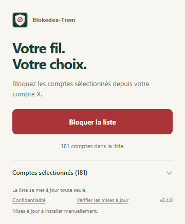

Blokedex-Trem
=============

Votre fil, votre choix. Un bouton pour bloquer les comptes sélectionnés avec votre propre compte X, déjà connecté dans le navigateur.

La liste « Comptes sélectionnés » est un choix de l’éditeur. Y figurer ne constitue pas une affirmation sur les opinions, les affiliations ou les intentions du titulaire. Les comptes sont consultables avant le lancement.

Installation
------------

**Chrome** : télécharger le `ZIP Chrome <https://github.com/LaRosette/Blokedex-Trem/releases/latest/download/extension-chrome.zip>`_, le décompresser, ouvrir ``chrome://extensions``, activer le mode développeur puis charger le dossier contenant ``manifest.json``.

**Edge** : télécharger le `ZIP Edge <https://github.com/LaRosette/Blokedex-Trem/releases/latest/download/extension-edge.zip>`_, le décompresser puis charger le dossier depuis ``edge://extensions`` en mode développeur.

**Firefox** : télécharger le `ZIP Firefox <https://github.com/LaRosette/Blokedex-Trem/releases/latest/download/extension-firefox.zip>`_, ouvrir ``about:debugging#/runtime/this-firefox`` puis choisir « Charger un module complémentaire temporaire ». Ce mode est retiré au redémarrage. Firefox 142 ou plus récent est nécessaire. Une installation permanente exige un XPI signé par Mozilla ; aucun XPI signé n’est encore distribué.

Connectez-vous à X, ouvrez l’extension et cliquez sur **Bloquer la liste**. Un seul onglet de travail sert à toute l’opération, sans ouvrir de fenêtre séparée. Le popup peut être fermé. En cas de pause, « Vérifier X » affiche l’onglet concerné ; « Reprendre » continue le traitement.

Mises à jour et nouveaux comptes
--------------------------------

La liste se récupère automatiquement. Après un premier passage, une pastille sur l’icône et un encart indiquent les nouveaux profils à traiter pour le dernier compte X confirmé. Le contrôle en arrière-plan est effectué toutes les six heures quand le navigateur est ouvert, et à l’ouverture de l’extension. Épinglez son icône pour voir la pastille.

Cette comparaison utilise la mémoire locale des profils déjà traités. Elle ne lit pas la liste privée des blocages sur le serveur X. Si vous avez débloqué quelqu’un directement dans X, « Tout revérifier » permet de refaire le parcours. Un ajout ne lance jamais de blocage sans votre clic.

Le popup signale aussi les nouvelles versions du logiciel. **Les ZIP Chrome et Edge installés manuellement demandent de remplacer les fichiers dans le même dossier puis de recharger l’extension.** Une première mise à jour manuelle est nécessaire depuis les anciennes versions. Les mises à jour natives de ces navigateurs passent par leurs boutiques, où le projet n’est pas encore publié.

Le canal Firefox GitHub est préparé pour de futurs XPI signés par Mozilla. Tant qu’aucun XPI signé n’est présent, il n’est pas actif. La publication GitHub ne met pas automatiquement l’extension dans les boutiques.

Proposer un compte ou demander un retrait
-----------------------------------------

**Pour faire retirer votre nom ou un compte de la liste, contactez** `@MEYTRED sur X <https://x.com/MEYTRED>`_ **avec le lien du profil concerné.** Ce contact sert aussi à demander un ajout ou signaler une erreur d’identité.

Seul l’éditeur publie les modifications de la liste officielle. Les demandes sont examinées, pas ajoutées automatiquement. Un retrait du fichier ne débloque pas les comptes déjà bloqués sur X. N’envoyez pas de mot de passe, cookie ou document d’identité dans une issue publique.

Comptes sélectionnés
--------------------

.. comptes:debut

**181 comptes** · liste 2026-10-28.2

Ce tableau suit les comptes sélectionnés. Les blocages des utilisateurs restent privés.

.. list-table::
   :header-rows: 1
   :widths: 20 20 20 20 20

   * - _ – C
     - C – G
     - G – L
     - L – R
     - R – Z
   * - `@_LesPatriotes <https://x.com/_LesPatriotes>`_
     - `@CathRimbert84 <https://x.com/CathRimbert84>`_
     - `@guillaumefl59 <https://x.com/guillaumefl59>`_
     - `@louis_aliot <https://x.com/louis_aliot>`_
     - `@RomainTonussi <https://x.com/RomainTonussi>`_
   * - `@A_Dutremble <https://x.com/A_Dutremble>`_
     - `@CColombier_RN <https://x.com/CColombier_RN>`_
     - `@HdeLepinau <https://x.com/HdeLepinau>`_
     - `@LRDehault <https://x.com/LRDehault>`_
     - `@RoullaudBeatric <https://x.com/RoullaudBeatric>`_
   * - `@A_Masson06 <https://x.com/A_Masson06>`_
     - `@Cengrand_ <https://x.com/Cengrand_>`_
     - `@HeleneLaporteRN <https://x.com/HeleneLaporteRN>`_
     - `@M_Dauchy <https://x.com/M_Dauchy>`_
     - `@RTolassy <https://x.com/RTolassy>`_
   * - `@Al_Nikolic <https://x.com/Al_Nikolic>`_
     - `@ChristineLoirRN <https://x.com/ChristineLoirRN>`_
     - `@ID_Libertes <https://x.com/ID_Libertes>`_
     - `@MagLincorrect <https://x.com/MagLincorrect>`_
     - `@S_Werbrouck <https://x.com/S_Werbrouck>`_
   * - `@AlexandreDfss <https://x.com/AlexandreDfss>`_
     - `@ChudeauR <https://x.com/ChudeauR>`_
     - `@J_Bardella <https://x.com/J_Bardella>`_
     - `@MalikaSorel <https://x.com/MalikaSorel>`_
     - `@Samuel_Lafont <https://x.com/Samuel_Lafont>`_
   * - `@AlexandreLoubet <https://x.com/AlexandreLoubet>`_
     - `@ClaireBeuil <https://x.com/ClaireBeuil>`_
     - `@J_Rancoule <https://x.com/J_Rancoule>`_
     - `@MAndrouet <https://x.com/MAndrouet>`_
     - `@SandraDELANNOY1 <https://x.com/SandraDELANNOY1>`_
   * - `@AlexandreVaraut <https://x.com/AlexandreVaraut>`_
     - `@CNEWS <https://x.com/CNEWS>`_
     - `@JeanMessiha <https://x.com/JeanMessiha>`_
     - `@MarcDeFleurian <https://x.com/MarcDeFleurian>`_
     - `@Sandrine_Dogor <https://x.com/Sandrine_Dogor>`_
   * - `@alexisjollyrn <https://x.com/alexisjollyrn>`_
     - `@Coll_Nemesis <https://x.com/Coll_Nemesis>`_
     - `@jerome_buisson <https://x.com/jerome_buisson>`_
     - `@MarchioMatthieu <https://x.com/MarchioMatthieu>`_
     - `@sblanc66000 <https://x.com/sblanc66000>`_
   * - `@Anais_Sabatini <https://x.com/Anais_Sabatini>`_
     - `@CordierAlice2 <https://x.com/CordierAlice2>`_
     - `@JLechanteux <https://x.com/JLechanteux>`_
     - `@MarieLuceBC <https://x.com/MarieLuceBC>`_
     - `@seb_humbert <https://x.com/seb_humbert>`_
   * - `@AndreRougeOff <https://x.com/AndreRougeOff>`_
     - `@DamienRieu <https://x.com/DamienRieu>`_
     - `@JLeonardelli_ <https://x.com/JLeonardelli_>`_
     - `@marine_hamelet <https://x.com/marine_hamelet>`_
     - `@sebchenu <https://x.com/sebchenu>`_
   * - `@angelique_ranc <https://x.com/angelique_ranc>`_
     - `@diaz_edwige <https://x.com/diaz_edwige>`_
     - `@jllacapelle <https://x.com/jllacapelle>`_
     - `@MarionMarechal <https://x.com/MarionMarechal>`_
     - `@Serge_Muller24 <https://x.com/Serge_Muller24>`_
   * - `@AnneSicard1 <https://x.com/AnneSicard1>`_
     - `@e_Fouquart <https://x.com/e_Fouquart>`_
     - `@JocelynDessigny <https://x.com/JocelynDessigny>`_
     - `@MassonBryan <https://x.com/MassonBryan>`_
     - `@SJosserand30 <https://x.com/SJosserand30>`_
   * - `@AntBoulogne54 <https://x.com/AntBoulogne54>`_
     - `@EddyCasterman <https://x.com/EddyCasterman>`_
     - `@JoelleMelinRN <https://x.com/JoelleMelinRN>`_
     - `@MatthiasRN <https://x.com/MatthiasRN>`_
     - `@sRambaudRN <https://x.com/sRambaudRN>`_
   * - `@antoine_golliot <https://x.com/antoine_golliot>`_
     - `@EmericSalmon <https://x.com/EmericSalmon>`_
     - `@jordan_guitton <https://x.com/jordan_guitton>`_
     - `@MauvieuxKevin <https://x.com/MauvieuxKevin>`_
     - `@T_Houssin <https://x.com/T_Houssin>`_
   * - `@ArnaudSa3 <https://x.com/ArnaudSa3>`_
     - `@Europe1 <https://x.com/Europe1>`_
     - `@JorysB3 <https://x.com/JorysB3>`_
     - `@MaximeAmblard5 <https://x.com/MaximeAmblard5>`_
     - `@TaverneMichael <https://x.com/TaverneMichael>`_
   * - `@ASabatou <https://x.com/ASabatou>`_
     - `@F_Desouche <https://x.com/F_Desouche>`_
     - `@joshuaHochart <https://x.com/joshuaHochart>`_
     - `@melanie_disdier <https://x.com/melanie_disdier>`_
     - `@tegnererik <https://x.com/tegnererik>`_
   * - `@asfrigout <https://x.com/asfrigout>`_
     - `@f_philippot <https://x.com/f_philippot>`_
     - `@JPGarraud <https://x.com/JPGarraud>`_
     - `@Meurin_P <https://x.com/Meurin_P>`_
     - `@Th_Bnrdt <https://x.com/Th_Bnrdt>`_
   * - `@Au_Evrard <https://x.com/Au_Evrard>`_
     - `@FabriceLeggeri <https://x.com/FabriceLeggeri>`_
     - `@JphTanguy <https://x.com/JphTanguy>`_
     - `@MichelGuiniot <https://x.com/MichelGuiniot>`_
     - `@ThaisEscufon <https://x.com/ThaisEscufon>`_
   * - `@AymericDurox <https://x.com/AymericDurox>`_
     - `@FalconFrederic <https://x.com/FalconFrederic>`_
     - `@jrechagneux <https://x.com/jrechagneux>`_
     - `@MichleMartinez3 <https://x.com/MichleMartinez3>`_
     - `@thierry_frappe <https://x.com/thierry_frappe>`_
   * - `@BallardPhilippe <https://x.com/BallardPhilippe>`_
     - `@Flo_Joubert <https://x.com/Flo_Joubert>`_
     - `@JRochedy <https://x.com/JRochedy>`_
     - `@MLP_officiel <https://x.com/MLP_officiel>`_
     - `@ThierryMARIANI <https://x.com/ThierryMARIANI>`_
   * - `@BarthesChristop <https://x.com/BarthesChristop>`_
     - `@FlorenceGoulet4 <https://x.com/FlorenceGoulet4>`_
     - `@jsanchez_rn <https://x.com/jsanchez_rn>`_
     - `@MoniqueGriseti <https://x.com/MoniqueGriseti>`_
     - `@thierryperez_ <https://x.com/thierryperez_>`_
   * - `@BaubryR <https://x.com/BaubryR>`_
     - `@FranceJamet <https://x.com/FranceJamet>`_
     - `@Julien_Limongi <https://x.com/Julien_Limongi>`_
     - `@MonnierThibaut <https://x.com/MonnierThibaut>`_
     - `@Thomas_Mng <https://x.com/Thomas_Mng>`_
   * - `@Bay_Christophe <https://x.com/Bay_Christophe>`_
     - `@FranceLorho <https://x.com/FranceLorho>`_
     - `@JulienGabarron <https://x.com/JulienGabarron>`_
     - `@mvalet_officiel <https://x.com/mvalet_officiel>`_
     - `@Tiffany_Joncour <https://x.com/Tiffany_Joncour>`_
   * - `@BeaurainJose <https://x.com/BeaurainJose>`_
     - `@franckallisio <https://x.com/franckallisio>`_
     - `@JulienOdoul <https://x.com/JulienOdoul>`_
     - `@NadineLechonRN <https://x.com/NadineLechonRN>`_
     - `@tvlofficiel <https://x.com/tvlofficiel>`_
   * - `@BeneAuzanot <https://x.com/BeneAuzanot>`_
     - `@FrankGiletti <https://x.com/FrankGiletti>`_
     - `@jylgallou <https://x.com/jylgallou>`_
     - `@NathCarvalho91 <https://x.com/NathCarvalho91>`_
     - `@TwitchGauchiste <https://x.com/TwitchGauchiste>`_
   * - `@BentzChristophe <https://x.com/BentzChristophe>`_
     - `@FredericVos <https://x.com/FredericVos>`_
     - `@K_Pfeffer <https://x.com/K_Pfeffer>`_
     - `@NicolasDragon <https://x.com/NicolasDragon>`_
     - `@v_joron <https://x.com/v_joron>`_
   * - `@BFMTV <https://x.com/BFMTV>`_
     - `@Frontieresmedia <https://x.com/Frontieresmedia>`_
     - `@knafo_sarah <https://x.com/knafo_sarah>`_
     - `@NMeizonnet <https://x.com/NMeizonnet>`_
     - `@ValerieDeloge <https://x.com/ValerieDeloge>`_
   * - `@BlairyEmmanuel <https://x.com/BlairyEmmanuel>`_
     - `@furet_angeline <https://x.com/furet_angeline>`_
     - `@LaureLavalette <https://x.com/LaureLavalette>`_
     - `@Parmentier_RN <https://x.com/Parmentier_RN>`_
     - `@Valeurs <https://x.com/Valeurs>`_
   * - `@Boccaletti83 <https://x.com/Boccaletti83>`_
     - `@G_Dussausaye <https://x.com/G_Dussausaye>`_
     - `@LaurentObertone <https://x.com/LaurentObertone>`_
     - `@PascalePiera <https://x.com/PascalePiera>`_
     - `@villedieu_a <https://x.com/villedieu_a>`_
   * - `@Bruno_Attal_ <https://x.com/Bruno_Attal_>`_
     - `@GabrielAttal <https://x.com/GabrielAttal>`_
     - `@LeBourgeois7610 <https://x.com/LeBourgeois7610>`_
     - `@Ph_Schreck <https://x.com/Ph_Schreck>`_
     - `@WEBERFrederic1 <https://x.com/WEBERFrederic1>`_
   * - `@BrunoBilde <https://x.com/BrunoBilde>`_
     - `@GalzyStephanie <https://x.com/GalzyStephanie>`_
     - `@leJDD <https://x.com/leJDD>`_
     - `@phlottiaux <https://x.com/phlottiaux>`_
     - `@YaelMenache <https://x.com/YaelMenache>`_
   * - `@BrunoClavet <https://x.com/BrunoClavet>`_
     - `@GillesPennelle <https://x.com/GillesPennelle>`_
     - `@LevavasseurK <https://x.com/LevavasseurK>`_
     - `@PhOlivierRN <https://x.com/PhOlivierRN>`_
     - `@YoannGillet30 <https://x.com/YoannGillet30>`_
   * - `@BrunoRetailleau <https://x.com/BrunoRetailleau>`_
     - `@gisele_lelouis <https://x.com/gisele_lelouis>`_
     - `@Ligne__Droite <https://x.com/Ligne__Droite>`_
     - `@PierrePimpie <https://x.com/PierrePimpie>`_
     - `@ZemmourEric <https://x.com/ZemmourEric>`_
   * - `@BVoltaire <https://x.com/BVoltaire>`_
     - `@GonzalezJoseRN <https://x.com/GonzalezJoseRN>`_
     - `@Lionel_Tivoli <https://x.com/Lionel_Tivoli>`_
     - `@PR_Thionnet <https://x.com/PR_Thionnet>`_
     - 
   * - `@C_GirardRN <https://x.com/C_GirardRN>`_
     - `@GrangierGe <https://x.com/GrangierGe>`_
     - `@LisettePollet <https://x.com/LisettePollet>`_
     - `@Reconquete_off <https://x.com/Reconquete_off>`_
     - 
   * - `@C_Jaouen_84 <https://x.com/C_Jaouen_84>`_
     - `@groupeRN_off <https://x.com/groupeRN_off>`_
     - `@ljacobelli <https://x.com/ljacobelli>`_
     - `@Rivirejoseph1 <https://x.com/Rivirejoseph1>`_
     - 
   * - `@C_Szczurek <https://x.com/C_Szczurek>`_
     - `@Guillaume_Bigot <https://x.com/Guillaume_Bigot>`_
     - `@LopezLiguori <https://x.com/LopezLiguori>`_
     - `@RNational_off <https://x.com/RNational_off>`_
     - 

.. comptes:fin

Téléchargements
---------------

Les compteurs ci-dessous mesurent les téléchargements de fichiers dans GitHub Releases. Ce ne sont ni des installations ni des personnes uniques. Aucun événement d’utilisation n’est envoyé par l’extension.

.. image:: https://img.shields.io/github/downloads/LaRosette/Blokedex-Trem/extension-chrome.zip?label=Chrome&color=183f35&displayAssetName=false
   :target: https://github.com/LaRosette/Blokedex-Trem/releases
   :alt: Téléchargements Chrome

.. image:: https://img.shields.io/github/downloads/LaRosette/Blokedex-Trem/extension-edge.zip?label=Edge&color=183f35&displayAssetName=false
   :target: https://github.com/LaRosette/Blokedex-Trem/releases
   :alt: Téléchargements Edge

.. image:: https://img.shields.io/github/downloads/LaRosette/Blokedex-Trem/extension-firefox.zip?label=Firefox&color=183f35&displayAssetName=false
   :target: https://github.com/LaRosette/Blokedex-Trem/releases
   :alt: Téléchargements Firefox

Confidentialité et risques
--------------------------

L’extension ne lit aucun mot de passe, cookie ou jeton de session. Le pseudo du compte connecté, la progression et les profils traités restent dans le navigateur. L’historique est séparé par compte à partir du pseudo et d’une empreinte de la référence publique de l’avatar, et limité à cinq comptes. Les repères des ajouts et les métadonnées de version sont aussi locaux. L’éditeur ne reçoit pas l’identité des utilisateurs ni leurs résultats de blocage. Il n’y a ni publicité ni télémétrie.

GitHub fournit la liste et les métadonnées publiques de version ; il reçoit les informations réseau habituelles, dont l’adresse IP. Ces requêtes n’envoient ni cookies GitHub, ni pseudo X, ni historique de blocage. X reçoit les navigations et les actions demandées avec la session déjà ouverte. Le navigateur et les boutiques ont leurs propres traitements pour les mises à jour natives. Les fichiers JSON ne contiennent aucun code exécuté à distance.

Désinstaller l’extension efface son stockage local, mais laisse les blocages sur X. Un blocage peut aussi supprimer les abonnements entre comptes. L’utilisateur peut arrêter le traitement ; une action déjà transmise peut néanmoins se terminer.

**X peut restreindre ou suspendre le compte, y compris définitivement.** L’outil utilise les commandes visibles du site, traite les profils l’un après l’autre, attend chaque confirmation et se met en pause en cas de limitation. Ces précautions ne rendent pas l’automatisation autorisée et ne permettent pas de chiffrer le risque. Le projet ne promet pas un risque « léger » ou « impossible ». `Règles officielles de X <https://help.x.com/en/rules-and-policies/x-automation>`_.

**Le nouveau titre ne constitue pas une validation RGPD.** Les pseudos et identifiants publics peuvent être des données personnelles. Le contexte peut révéler ou attribuer des opinions politiques, qui sont sensibles. Une base légale de l’article 6 et, le cas échéant, une exception de l’article 9 sont deux conditions distinctes. Le changement de nom ou l’absence de télémétrie ne les établit pas. `Explications de la CNIL <https://www.cnil.fr/fr/les-bases-legales/liceite-essentiel-sur-les-bases-legales>`_.

La liste est une sélection de l’éditeur, pas un classement politique. Les références d’identité ne contiennent plus de noms complets ni de commentaires de qualification dans la version courante. Cela ne les rend pas anonymes. Les anciennes copies du dépôt peuvent conserver les anciens textes. Une analyse juridique de la publication reste nécessaire avant de la présenter comme conforme ; le projet n’est ni approuvé par X, ni certifié par la CNIL.

Pour une correction, un retrait, un accès ou l’examen d’une opposition, contacter `@MEYTRED <https://x.com/MEYTRED>`_. Les demandes doivent être traitées selon le droit applicable. La `CNIL explique les droits et les délais de réponse <https://www.cnil.fr/fr/cnil-direct/question/comment-faire-supprimer-des-informations-me-concernant-diffusees-sur-internet>`_. Le contact public ne remplace pas les mentions d’identification de l’exploitant exigées par la loi.

Développement et publication
----------------------------

Node.js 22 ou plus récent pour les outils ; aucune dépendance npm dans les ZIP de l’extension.

::

   npm ci --ignore-scripts
   npm test
   npm run validate:list
   npm run build
   npm run lint:firefox
   npm run release:prepare

Les tests navigateur utilisent des comptes fictifs. Sous Windows, ``TEST_BROWSER_CHANNEL=msedge`` permet de tester avec Edge. Les paquets sont vérifiés et leurs empreintes SHA-256 accompagnent chaque release. Les corrections de code demandent une nouvelle version, les changements de liste non.

L’outil Mozilla de développement comporte une alerte npm de sévérité faible dans une dépendance transitive. Elle n’est pas embarquée dans les paquets ; l’audit des dépendances de production est sans alerte. Les vérifications ne constituent pas une garantie d’absence de tout défaut.

Pour publier : mettre la même version dans le manifeste et package.json, puis lancer **Actions → Publier une version** avec le tag correspondant. La signature Firefox est facultative : créer les identifiants API dans le Developer Hub Mozilla puis enregistrer ``AMO_JWT_ISSUER`` et ``AMO_JWT_SECRET`` dans les secrets GitHub Actions. Ne jamais les mettre dans le dépôt ou un message. Cocher ``sign_firefox`` demande une signature ``unlisted``, une comparaison des sources et une installation permanente de contrôle dans Firefox Release. Sans succès de ces contrôles, aucun XPI ni flux Firefox n’est publié.

Les métadonnées de version ne sont promues qu’après vérification de la release publique, immuable et complète. Une signature Mozilla ou une validation de boutique reste à obtenir : elle n’est pas simulée. Chrome et Edge exigent un dépôt de leurs ZIP et une validation dans leurs boutiques pour la distribution grand public avec mises à jour natives.
